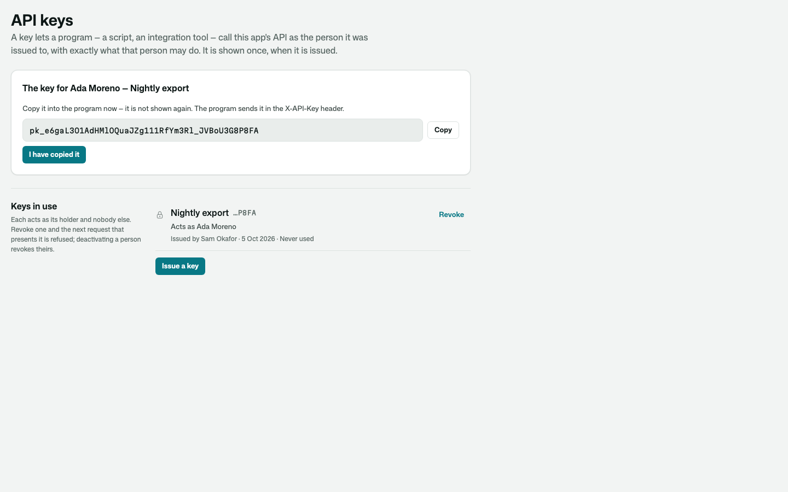
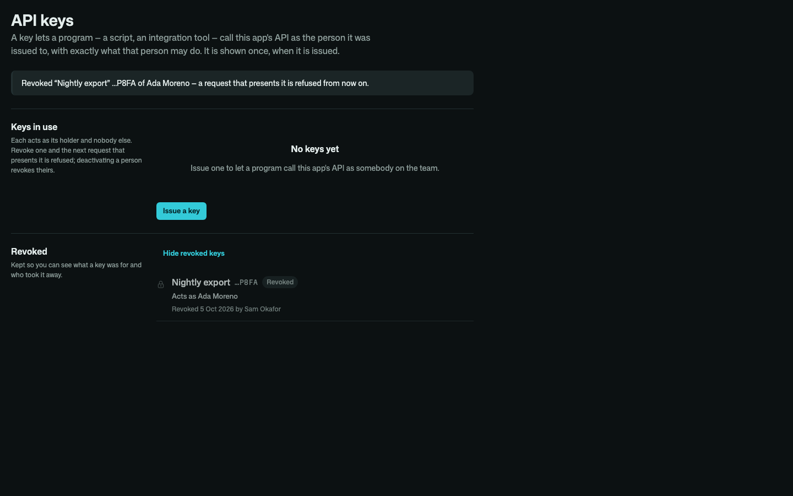
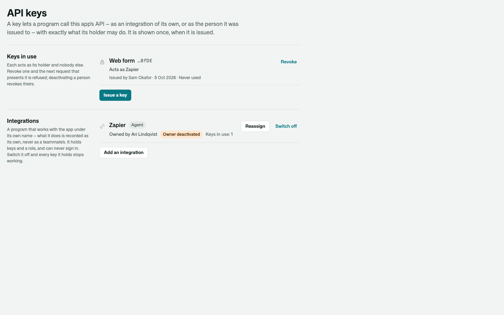
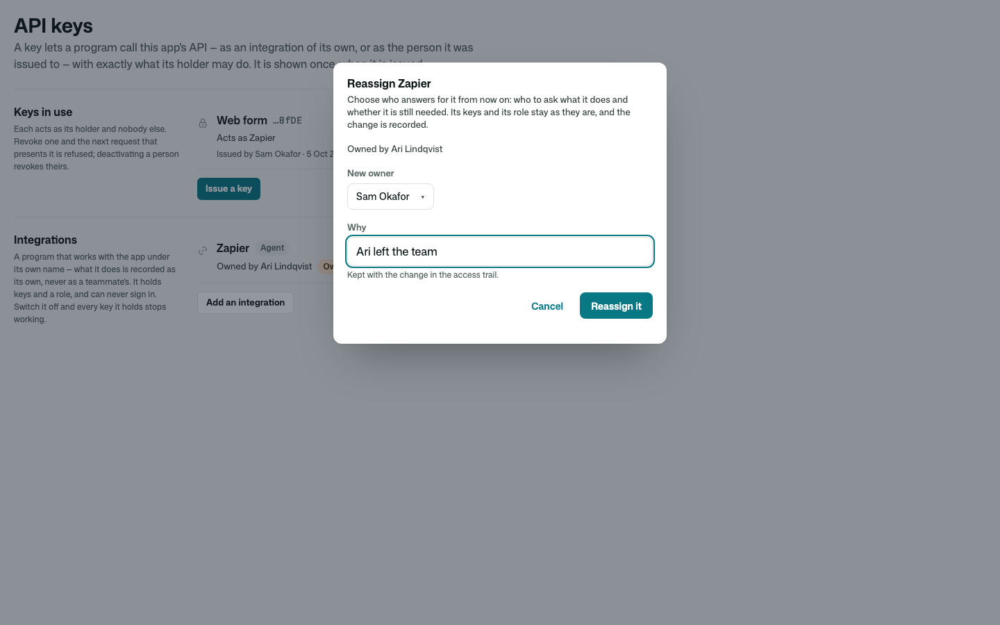
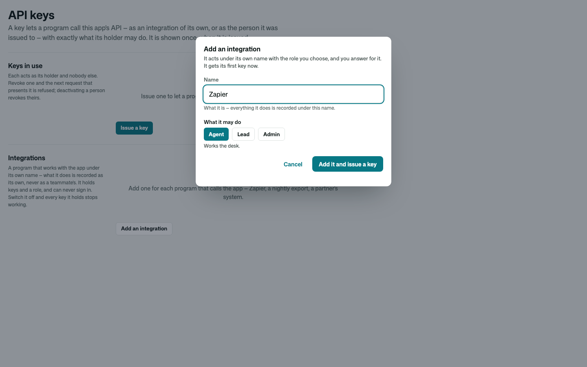
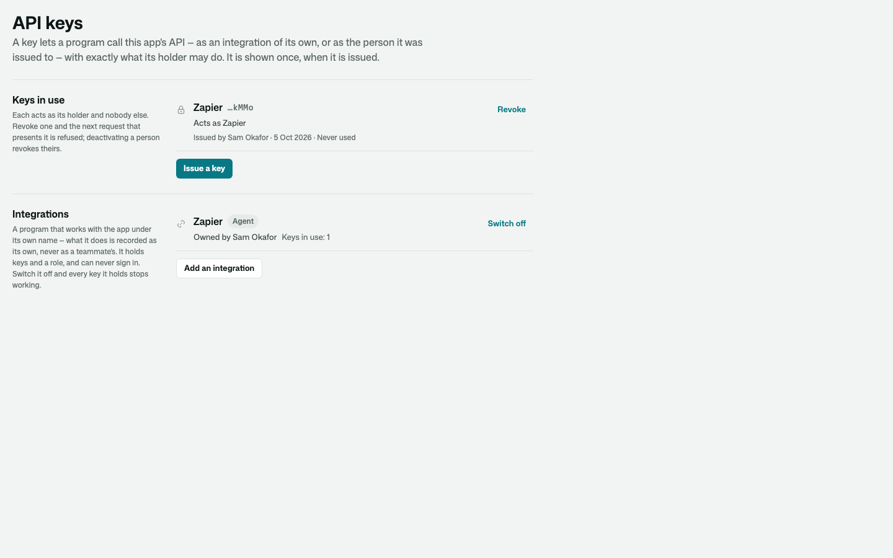

# Osysharp.UserManagement

The **user manager**: who is in the app, what each of them may do, and who changed that — when, and why.

- A **people list** — search by name or address; each person's roles (by the names the app gives them), whether two-step
  sign-in is on, whether their address is proven, when they last signed in; deactivated people kept and marked.
- A **person in full** — their app roles and the roles they hold in organisations, where else they are signed in right
  now, and the history of every change to their access (and the invitation they joined by).
- **Changes**, each one a record first: grant and revoke the app's roles · deactivate and reactivate · reset a lost
  second factor · sign out everywhere · add to and remove from an organisation, and grant roles within one.

## Use it

```osy
// app.osy
use Osysharp.Identity@0;
use Osysharp.UserAccounts@1;
use Osysharp.Organizations@0;
use Osysharp.Invitations@2;
use Osysharp.UserManagement@0;
```

```osy
using Osysharp.Identity;
using Osysharp.UserManagement;

[Role] enum AppRole { Authenticator, Agent, Lead, Admin, Integration }
policy IsAdmin => RoleGrant.Any(g => g.Member == user && g.Role == AppRole.Admin);

policy ManagesPeople => IsAdmin;            // who changes people's access
policy MayInvite => IsAdmin;                // Osysharp.Invitations
policy ManagesOrganizations => IsAdmin;     // Osysharp.Organizations

// The roles a manager may hand out, by the names people read. A role not listed is never offered — `Integration` here.
app.Roles = new RolesSetup { Offered = [
  new RoleChoice { Role = AppRole.Agent, Label = "Agent", Description = "Works tickets." },
  new RoleChoice { Role = AppRole.Lead, Label = "Lead", Description = "Watches the queues." },
  new RoleChoice { Role = AppRole.Admin, Label = "Admin", Description = "Runs the desk." },
] };

// A role held only inside an organisation is given only there — `HeldIn = RoleScope.Organization` on its RoleChoice.

// The role the app must never be left without an active holder of.
app.People = new PeopleSetup { KeepOneOf = AppRole.Admin };

// The user manager READS who holds which role — every change goes through it, so grant nothing more here.
partial entity RoleGrant { security { allow read when ManagesPeople; } }
```

Then put `PeopleManager()` on a page only managers reach (it is a `[Composable]`; it brings the invite form and the
waiting invitations with it).

From code: `GrantRole(p, AppRole.Lead, "covering December")`, `RevokeRole`, `Deactivate(p, "left")`, `Reactivate`,
`ResetSecondFactor(p, "lost phone — confirmed by a call")`, `SignOutEverywhere(p)`, `AddToOrganization(org, p)`,
`GrantInOrganization(org, p, AppRole.Lead)`; reads `PeopleList(search)`, `PersonDetailOf(id)`, `AccessTrail()`.

## API keys

A people manager issues a teammate an API key on `/settings/api-keys` (or `ApiKeyManager()` on a page of your own), so
that a program can call the app's REST API as that teammate, with exactly what they may do. The key is shown **once**,
with a copy button, and only its hash is kept on the person's account (two at a time, so a key can be replaced with no
gap). The list says whose each key is, what it is for, who issued it and when it was last used. Revoking one, or
deactivating its holder, refuses it from the next request. Issuing and revoking are access changes like any other,
on the trail with who did it and why. From code: `IssueApiKey(p, "Nightly export").Key`, `RevokeApiKey(key)`.

| Shown once, after it is issued | Revoked, in the dark |
|---|---|
|  |  |

## Integrations

Zapier, a nightly export, a partner's system: a program that works with your app should do it under its own name, not
a teammate's. An **integration** is an account of its own — a name, the role it acts with, the person who answers for
it, and API keys — with no mailbox and no password, and no way to sign in. Everything it does through the API is
recorded as its own ("Zapier added a note"), so the trail never blames a person for a program.

A people manager adds one on the same page — a name and what it may do — and is shown its first key once. It is listed
with its role, its owner and how many keys it holds; **Switch off** deactivates it, and every key it holds is refused
from the next request. Adding one is an access change on the trail, like any other. From code:
`AddIntegration("Zapier", AppRole.Agent)` then `IssueApiKey(zapier, "Web form").Key`.

An integration outlives the person who answers for it. When they leave and their account is deactivated, the program
keeps working, and its row says **Owner deactivated**. **Reassign** gives it to somebody who is here, with a reason, as
an access change on the trail like any other. From code: `ReassignIntegration(zapier, sam, "Ari left the team")`.

| Its owner has left | Given to somebody who is here |
|---|---|
|  |  |

| Adding one | Listed with its role, owner and keys |
|---|---|
|  |  |

## Every change is a record first

A manager never writes somebody's access directly. Each change is an `AccessChange` — who made it, to whom, what, when
and why — and its run applies it **in the same commit**. Only the app's people managers may make one, naming
themselves; nobody edits or deletes one. So the trail of who changed whose access is not a log that might be missing a
path: it is the only path.

The run checks every change before it applies it — a record made without the functions' own checks is **refused**, with
the reason, and nothing changes:

- a role is granted only if the app **offers** it (`app.Roles`) — never `Authenticator`, never an integration role;
- a manager never deactivates **themself**, and the app is never left without an **active** holder of `KeepOneOf`;
- a second factor is reset only with a **reason** written down;
- deactivating, resetting a second factor and signing out everywhere end every session the person has, on every server,
  and each ended session is told an administrator changed the account's access — not that its password changed.

Resetting a second factor clears the authenticator, the recovery codes and a texted step, mails the person, and signs them
out: they sign in with their password and set it up again — or, where the app requires it, the sign-in asks them to.

## Examples

Taken from this package's own tests, which compile and run on every release.

```osy
using Osysharp.Identity;
using Osysharp.UserAccounts;
using Osysharp.Organizations;
using Osysharp.UserManagement;
using Osysharp.Mail;

[Test(Team)]
void a_manager_grants_and_revokes_an_offered_role_and_each_change_is_recorded() {
  var mo = Person("mo@desk.test");
  runas (Sam) { GrantRole(mo, AppRole.Lead, "Covering the queue in December"); }
  runas (Mo) { Assert.True(RoleGrant.Any(g => g.Member == Mo && g.Role == AppRole.Lead)); }
  runas (Sam) { RevokeRole(mo, AppRole.Lead); }
  runas (Mo) { Assert.False(RoleGrant.Any(g => g.Member == Mo && g.Role == AppRole.Lead)); }
  runas (Sam) {
    var trail = AccessChange.Where(c => c.Person == mo).OrderBy(c => c.At).ToList();
    Assert.Equal(2, trail.Count);
    Assert.Equal(AccessChangeKind.RoleGranted, trail[0].Kind);
    Assert.Equal("sam@desk.test", trail[0].By.Email);
    Assert.Equal("Covering the queue in December", trail[0].Reason);
    Assert.Equal(AccessChangeKind.RoleRevoked, trail[1].Kind);
  }
}
```

From [`tests/access.test.osy`](tests/access.test.osy).

```osy
using Osysharp.Identity;
using Osysharp.UserAccounts;
using Osysharp.UserManagement;

[Test(Team)]
void a_key_acts_as_the_person_it_was_issued_to_and_a_revoked_key_is_refused_at_once() {
  var ada = Person("ada@desk.test");
  IssuedApiKey issued = new IssuedApiKey();
  runas (Sam) { issued = IssueApiKey(ada, "Nightly export"); }
  Assert.StartsWith("pk_", issued.Key);
  // The key is Ada — not Sam, who issued it.
  Assert.Contains("ada@desk.test", Me(issued.Key));
  Assert.DoesNotContain("sam@desk.test", Me(issued.Key));
  runas (Sam) {
    var k = ApiKey.Single(x => x.Id == issued.Id);
    Assert.Equal(1, k.Slot);
    Assert.Equal("…" + issued.Key.Substring(issued.Key.Length - 4), k.Ending);
    // Its use is recorded, to the minute.
    Assert.NotNull(User.Single(u => u.Email == "ada@desk.test").ApiKeyUsedAt);
    RevokeApiKey(k, "Export moved to the warehouse");
  }
  // Refused at the very next request.
  Assert.Equal("HTTP 401", Me(issued.Key));
  runas (Sam) {
    var trail = AccessChange.Where(c => c.Person == ada).OrderBy(c => c.At).ToList();
    Assert.Equal(AccessChangeKind.ApiKeyIssued, trail[0].Kind);
    Assert.Equal(AccessChangeKind.ApiKeyRevoked, trail[1].Kind);
    Assert.Equal("Export moved to the warehouse", trail[1].Reason);
    Assert.Contains("Revoked the API key “Nightly export”", AccessTrail()[0].What);
  }
}
```

From [`tests/api-keys.test.osy`](tests/api-keys.test.osy).

```osy
using Osysharp.Identity;
using Osysharp.UserAccounts;
using Osysharp.UserManagement;

[Test(Team)]
void the_integrations_page_reads_the_same_however_many_integrations_there_are() {
  runas (Sam) {
    var first = AddIntegration("Program 1", AppRole.Agent, reason: "A test");
    IssueApiKey(first, "Key 1");
  }
  var one = 0;
  runas (Sam) {
    var mark = Cost.Mark();
    IntegrationLines();
    one = Cost.StatementsSince(mark);
  }
  runas (Sam) {
    for (var i = 2; i <= 6; i++) {
      var made = AddIntegration("Program " + i, AppRole.Agent, reason: "A test");
      IssueApiKey(made, "Key " + i);
    }
  }
  runas (Sam) {
    var mark = Cost.Mark();
    var lines = IntegrationLines();
    var six = Cost.StatementsSince(mark);
    Log.Information("IntegrationLines: " + one + " statements with one integration, " + six + " with six");
    Assert.Equal(6, lines.Count);
    Assert.Equal(1, lines.Single(l => l.Name == "Program 6").Keys);
    Assert.Equal("Agent", lines.Single(l => l.Name == "Program 6").Roles);
    Assert.Equal(one, six);
  }
}
```

From [`tests/cost.test.osy`](tests/cost.test.osy).

## Learn more

- [The Osysharp.UserManagement reference](https://osysharp.com/reference/security/people-kit/)
- [Osysharp.UserManagement in the package catalogue](https://osysharp.com/packages/#osysharp-usermanagement)
- [The Osy# reference](https://osysharp.com/reference/) — the language, the runtime and every kit
- [`llms-full.txt`](https://osysharp.com/llms-full.txt) — the whole reference and specification as one Markdown file, for a coding agent

## Licence

MIT — see [`LICENSE`](LICENSE).
